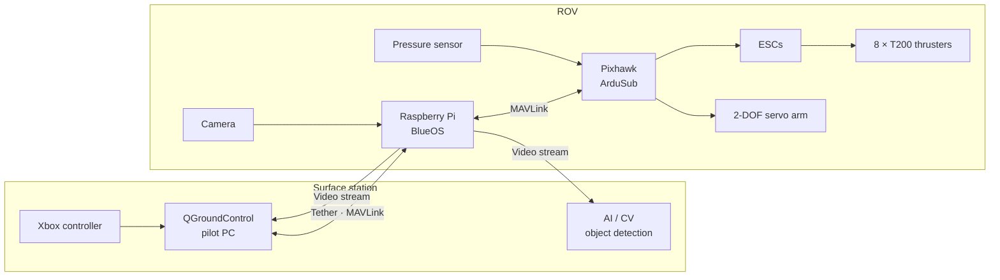

# MATE ROV — RedSea Rovers

A 6-DOF underwater ROV built by the **RedSea Rovers** team for the MATE ROV Competition. This repository documents the **control and software system**: how the pilot's commands travel from the surface to the thrusters, how the vehicle stays stable, and how the camera feed is used for AI-based object detection.

> Built and documented by the Control & Software team, led by [Abdullah Binsalman](https://github.com/Abdullah-BS).

---

## At a glance

| Area | What we used |
|---|---|
| **Flight controller** | Pixhawk running **ArduSub** firmware |
| **Companion computer** | Raspberry Pi running **BlueOS** |
| **Surface station** | PC running **QGroundControl** + Xbox controller |
| **Propulsion** | 8 × Blue Robotics **T200** thrusters, full **6 degrees of freedom** |
| **Sensors** | Pressure (depth) sensor, onboard IMU, camera |
| **Manipulator** | 2-DOF robotic arm driven by servos |
| **Vision** | AI / computer-vision object detection on the camera stream |
| **Fabrication** | Arm and custom parts **3D printed** |

---

## System architecture



**How a command flows:**

1. The pilot moves the Xbox controller. QGroundControl turns stick and button inputs into MAVLink manual-control messages.
2. The messages travel down the tether to the **Raspberry Pi**, where **BlueOS** routes them to the Pixhawk.
3. **ArduSub** on the Pixhawk mixes the 6-DOF command (surge, sway, heave, roll, pitch, yaw) into individual outputs for the 8 thrusters, and drives the arm servos.
4. Telemetry (depth, attitude, battery) and the live camera feed travel back up to the surface.

---

## Control system

### 6-DOF thruster layout
Eight T200 thrusters give independent control of all six axes, so the ROV can translate in any direction and hold its orientation while it does. ArduSub handles the thruster mixing, so the pilot commands *motion*, not individual motors.

### Stabilisation
- **Depth hold:** the pressure sensor feeds ArduSub's depth controller, so the ROV holds its depth hands-free.
- **Attitude hold:** the Pixhawk's IMU keeps roll, pitch and heading steady against currents and tether drag.

### Pilot interface
QGroundControl is the pilot console. It shows the live video, the telemetry overlay and the flight modes, and maps the Xbox controller to vehicle motion and arm control.

### Robotic arm
A **2-DOF arm** with servo joints, fully 3D printed, used for the competition's grab and manipulate tasks and controlled from the same gamepad.

---

## AI & computer vision

The camera stream from BlueOS is also processed by an object-detection pipeline. It identifies mission targets in the video, which helps the pilot find and approach objects during tasks.

---

## Repository contents

| File | Purpose |
|---|---|
| [`controller_button_definition.py`](controller_button_definition.py) | Xbox controller input inspector. It prints every button, axis and D-pad event live, and was used to map controls before building the MAVLink RC sender. |

```bash
pip install pygame
python controller_button_definition.py
```

---

## Tech stack

`ArduSub` · `BlueOS` · `Pixhawk` · `Raspberry Pi` · `QGroundControl` · `MAVLink` · `Python` · `Computer Vision` · `3D Printing`
